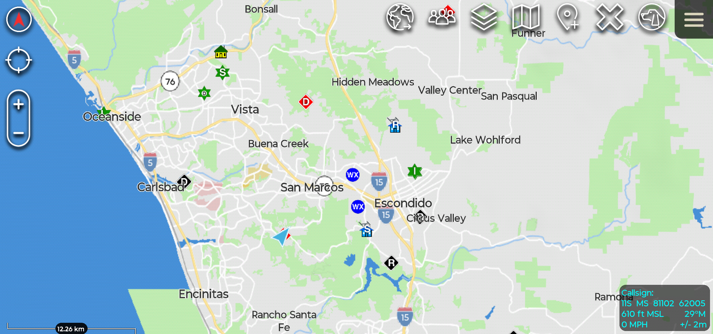

# APRS2TAK

Shows APRS stations heard by **APRSdroid** on the **ATAK** map, with their real APRS symbols. Everything runs on the phone: no internet, no TAK server, no laptop, and no ATAK plugin, so it works with the regular Play Store ATAK-CIV and alongside your other plugins.



```
radio ──► APRSdroid (decodes APRS) ──► APRS2TAK ──► ATAK map (127.0.0.1:4242 UDP)
```

## What you need

- An Android phone with **ATAK-CIV** (Play Store or tak.gov)
- **APRSdroid**, set up and receiving APRS (radio + audio interface such as a DigiRig, a Bluetooth TNC, or APRS-IS)
- From this release: `APRS2TAK.apk` and `aprs-iconset.zip`

## Install

1. **Install the app.** Copy `APRS2TAK.apk` to the phone and open it. Android will ask you to allow installing from that source (Files, Chrome, etc.); allow it.
2. **Import the APRS symbols into ATAK.** Copy `aprs-iconset.zip` to the phone (e.g. the Download folder). In ATAK: **☰ → Import → Local SD**, then pick `aprs-iconset.zip`. In Point Dropper you should now see an iconset named **APRS**.
3. **Check ATAK's input.** In ATAK: **Settings → Network Preferences → Network Connection Preferences → Manage Inputs**. The **Default** input `0.0.0.0:4242:udp` must be present and checked. It is by default.
4. **Battery settings.** Set both APRSdroid and APRS2TAK to **Unrestricted** battery (Settings → Apps → [app] → Battery), so the phone doesn't pause them in the background.

## Use

1. Open **APRS2TAK**, allow notifications, optionally enter **your callsign**, set how long stations stay on the map, and tap **Start bridge**.
2. Start **APRSdroid** as usual.
3. Open ATAK. Stations appear as they're heard. Tap one to see the raw packet in its remarks.

**Settings**

- **My callsign (optional)**: enter the exact callsign and SSID APRSdroid beacons as (e.g. `N0CALL-7`) to hide that station, since ATAK already shows your position. Your other stations (home, iGate, digi) still show. Leave it blank to show everything.
- **Keep stations on the map for**: minutes after a station's last beacon (1–1440, default 30). Takes effect on each station's next beacon.

## Symbols

APRS2TAK reads the symbol from each packet (regular, compressed, Mic-E, objects, items, third-party) and tells ATAK which icon to use from the APRS iconset. Common overlay symbols (for example `I&` iGate, `R&` RX-only iGate, `L&` LoRa iGate, `1#` fill-in digi) show their overlay character. Less common overlays show the plain symbol.

## Troubleshooting

- **Stations show as yellow clovers instead of APRS symbols**: the iconset isn't imported, or an older copy is. Re-import `aprs-iconset.zip` from this release, restart ATAK, and delete the old markers.
- **Nothing shows up**: check that APRS2TAK says "Status: running" and its counter goes up when APRSdroid hears stations. If the counter goes up but ATAK shows nothing, check the Default 4242 UDP input (Install step 3).
- **The counter doesn't go up**: APRSdroid isn't hearing anything (check its log screen) or isn't running.

## Credits

- APRS symbols: the aprs.fi APRS symbol set by Heikki Hannikainen, OH7LZB, <https://github.com/hessu/aprs-symbols>. See that project's COPYRIGHT file for per-symbol sources.
- APRSdroid inter-app API: <https://aprsdroid.org/api/>

Not affiliated with the TAK Product Center, APRSdroid or aprs.fi.
